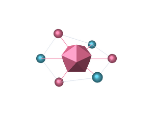
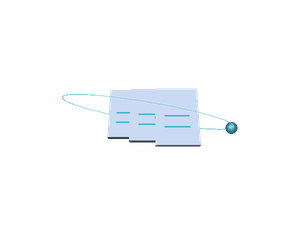
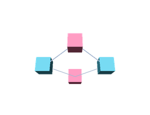
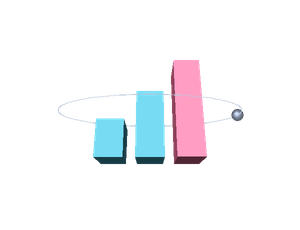
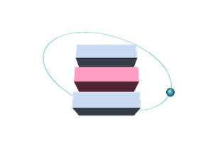
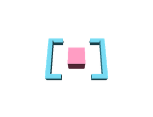
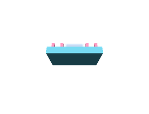
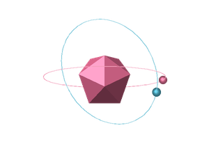

  
<strong>JOSÉ RIOS · IA & AUTOMAÇÃO</strong>

  <h1>Da pergunta à ação, com IA.</h1>
  
Modelos no centro. Dados, agentes e ferramentas em órbita.

  
  
<a href="#ia-e-agentes">IA e agentes</a> · <a href="#projetos">Projetos</a> · <a href="#contato">Contato</a>

Eu sou José Rios. Meu foco é <strong>inteligência artificial aplicada</strong>: conectar modelos, contexto e ferramentas para construir agentes e automatizar tarefas. Gosto de acompanhar o caminho inteiro, da pergunta inicial ao fluxo funcionando.

Por aqui, meus projetos contam essa história: documentos viram contexto, agentes ganham ferramentas, tarefas se conectam e os dados ajudam a entender o resultado.

<h2>01 · O centro da minha órbita</h2>

<table>
<tr>
<td width="70%">
  <h3>IA que participa do trabalho.</h3>
  
Minha principal área de atuação é IA. Trabalho com modelos e assistentes para explorar ideias, desenvolver soluções e conectar capacidades diferentes em um mesmo fluxo.

  
<strong>Modelos e assistentes</strong> 
  <code>Claude</code> <code>ChatGPT</code> <code>Gemini</code> <code>Groq</code> <code>NVIDIA AI</code>

  
<strong>Construção de agentes</strong> 
  <code>LangChain</code> <code>LangGraph</code> <code>Multiagentes</code> <code>Skills</code> <code>MCP</code> <code>Tool calling</code>

</td>
<td width="30%" align="center"></td>
</tr>
</table>

Um agente fica mais útil quando consegue consultar informação, usar uma ferramenta e devolver algo que ajude na próxima etapa. É nessa conexão que concentro meu trabalho.

<h2>02 · Antes de responder, buscar contexto</h2>

<table>
<tr>
<td width="30%" align="center"></td>
<td width="70%">
  <h3>Dos documentos à resposta.</h3>
  
Com RAG, conecto a geração de respostas a uma base de conhecimento. O percurso passa por ingestão, divisão de documentos, embeddings, busca vetorial e contexto para o modelo.

  
<code>RAG</code> <code>Embeddings</code> <code>Busca vetorial</code> <code>ChromaDB</code> <code>Supabase</code> <code>PostgreSQL</code>

  
No <a href="https://github.com/joseriosx/RAG_E-book">RAG E-book</a>, esse caminho liga um PDF à recuperação de trechos e à exportação das respostas em um novo documento.

</td>
</tr>
</table>

<h2>03 · A resposta vira uma ação</h2>

<table>
<tr>
<td width="70%">
  <h3>Automação é a ponte.</h3>
  
Conecto serviços, eventos e tarefas para que uma entrada siga seu caminho: receber uma solicitação, classificar, consultar uma fonte e entregar o resultado.

  
<strong>Automação e orquestração</strong> 
  <code>n8n</code> <code>Apache Airflow</code> <code>APIs REST</code> <code>Webhooks</code>

  
<strong>Serviços conectados nos projetos</strong> 
  <code>Google Drive</code> <code>Google Sheets</code> <code>Google Docs</code> <code>Gmail</code> <code>RSS</code>

</td>
<td width="30%" align="center"></td>
</tr>
</table>

No meu <a href="https://github.com/joseriosx/N8N">hub de automações n8n</a>, isso aparece em agentes com ferramentas, triagem de chamados, análise de sentimentos e geração de relatórios.

<h2>04 · O que acontece vira dado</h2>

<table>
<tr>
<td width="30%" align="center"></td>
<td width="70%">
  <h3>Organizar para entender.</h3>
  
Dados sustentam o contexto dos agentes e ajudam a acompanhar processos. Meus projetos passam por armazenamento, pipelines e visualização.

  
<code>Power BI</code> <code>PostgreSQL</code> <code>Supabase</code> <code>ETL</code> <code>Apache Airflow</code>

  
No <a href="https://github.com/joseriosx/airflow-simplificado">Airflow Simplificado</a>, reúno DAGs de exemplo, um pipeline de vendas e ambientes com Docker para explorar a orquestração.

</td>
</tr>
</table>

<h2>05 · Colocar as peças para funcionar</h2>

<table>
<tr>
<td width="70%">
  <h3>A infraestrutura faz parte do caminho.</h3>
  
Também trabalho com as ferramentas que sustentam a execução: organizar ambientes, empacotar serviços, versionar mudanças e colocar aplicações no ar.

  
<code>AWS</code> <code>Docker</code> <code>Docker Compose</code> <code>Dokploy</code> <code>Git</code> <code>GitHub</code>

</td>
<td width="30%" align="center"></td>
</tr>
</table>

<h2>06 · Código como ferramenta</h2>

<table>
<tr>
<td width="30%" align="center"></td>
<td width="70%">
  <h3>Linguagens a serviço da solução.</h3>
  
Uso <strong>Python</strong> em scripts, integrações e experimentos com IA. Meu foco está em construir a solução e conectar suas partes.

  
<strong>Linguagem</strong> <code>Python</code>

  
<strong>Formatos e ferramentas de apoio</strong> 
  <code>JSON</code> <code>Markdown</code> <code>Jupyter</code> <code>uv</code> <code>VS Code</code>

</td>
</tr>
</table>

<h2>07 · Ainda há espaço para experimentar</h2>

<table>
<tr>
<td width="70%">
  <h3>Do fluxo digital ao mundo físico.</h3>
  
Arduino e experimentos com hardware também fazem parte da minha caixa de ferramentas. São outros caminhos para explorar entradas, saídas e novas conexões.

  
<code>Arduino</code> <code>Prototipação</code>

</td>
<td width="30%" align="center"></td>
</tr>
</table>

<h2>Quando a ideia vira projeto</h2>

Alguns caminhos públicos para explorar o que construo e estudo:

<table>
<tr><th align="left">Projeto</th><th align="left">O caminho que ele mostra</th></tr>
<tr><td><a href="https://github.com/joseriosx/N8N"><strong>n8n Automation Hub</strong></a></td><td>IA integrada a serviços: RAG, agentes com ferramentas, classificação e relatórios.</td></tr>
<tr><td><a href="https://github.com/joseriosx/RAG_E-book"><strong>RAG E-book</strong></a></td><td>Do documento à resposta: embeddings, recuperação de contexto e geração de PDF.</td></tr>
<tr><td><a href="https://github.com/joseriosx/airflow-simplificado"><strong>Airflow Simplificado</strong></a></td><td>Da tarefa ao pipeline: DAGs, ETL e ambientes com Docker.</td></tr>
<tr><td><a href="https://github.com/joseriosx/FunilSocial"><strong>Funil Social</strong></a></td><td>Da ideia à experiência: um projeto educativo com jornada de conversão e métricas.</td></tr>
</table>

  
  
  <h2>A próxima conexão</h2>
  
Uma tarefa repetitiva, uma base de conhecimento ou uma ideia para tirar do papel?

  
<strong>Vamos conversar sobre o que podemos construir.</strong>

  
<a href="mailto:joseriosjr03@gmail.com">joseriosjr03@gmail.com</a> · <a href="https://www.instagram.com/junio.riosx/">Instagram</a> · <a href="https://github.com/joseriosx?tab=repositories">Mais repositórios</a>

